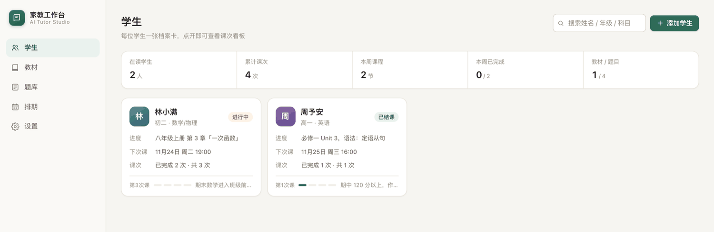
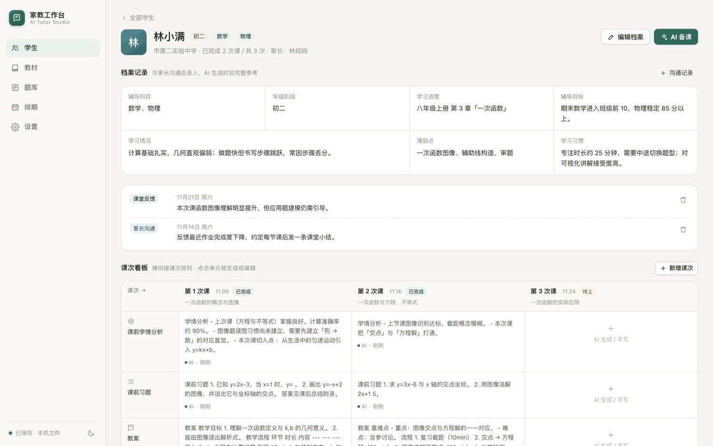
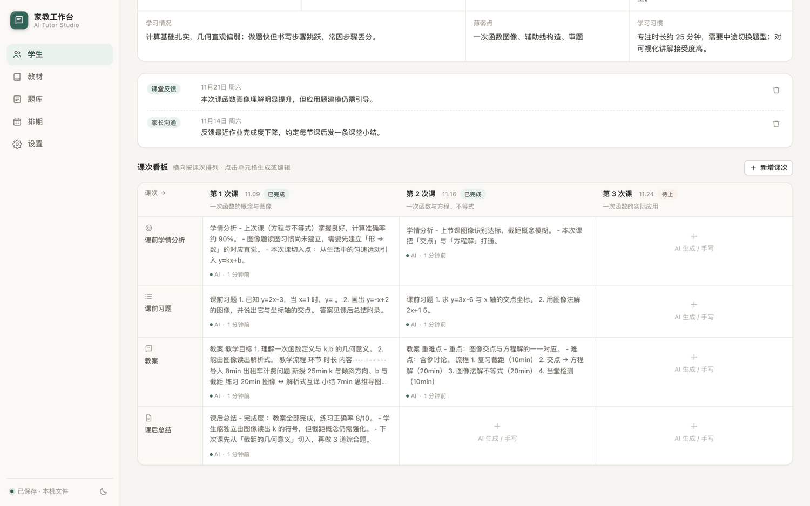
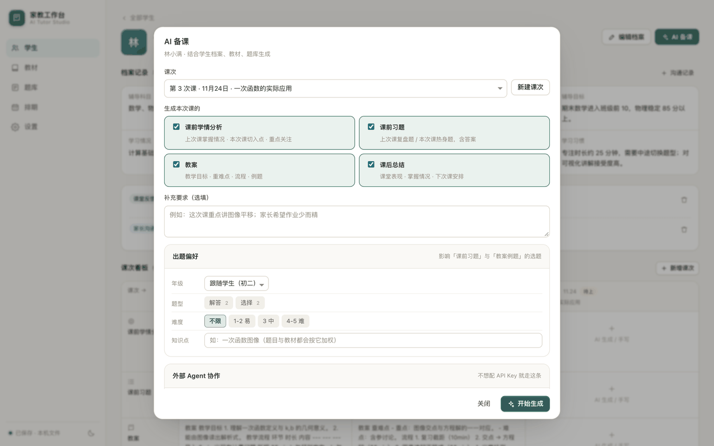
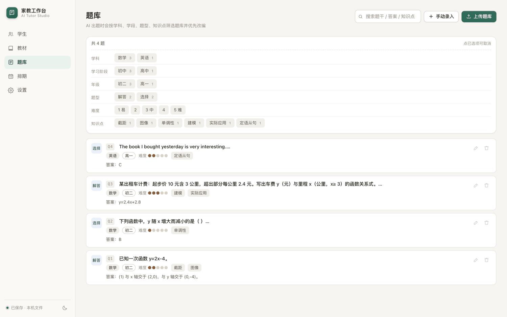
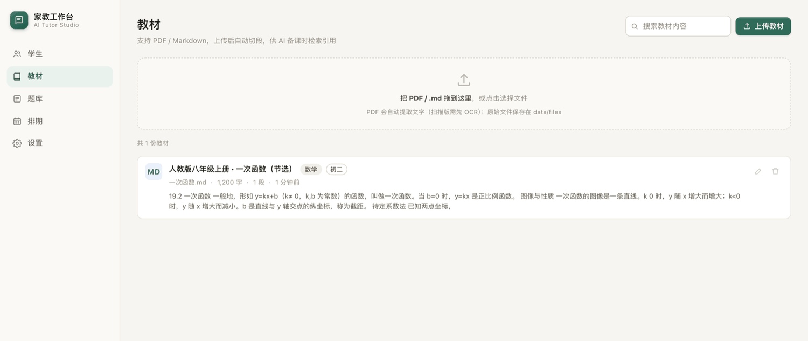
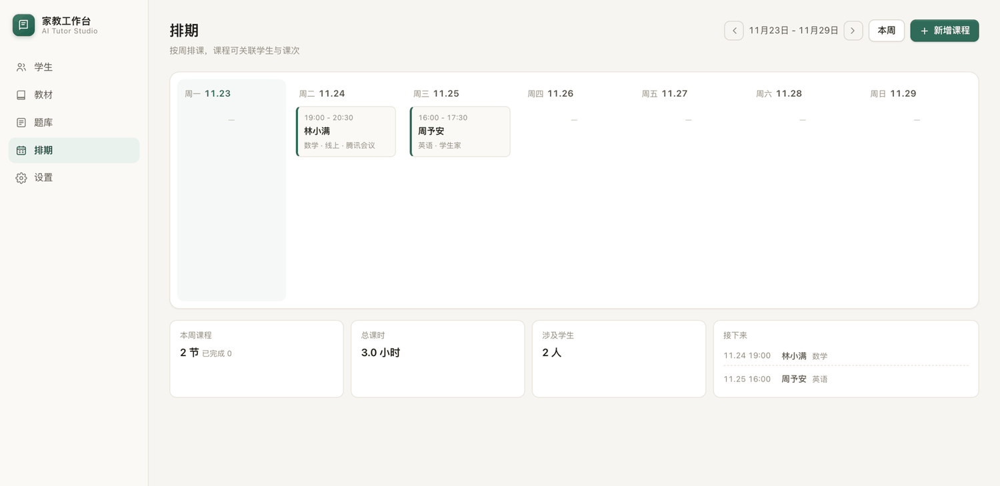
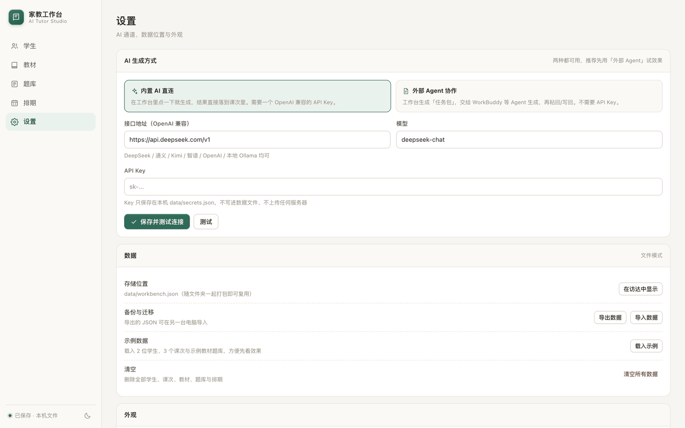
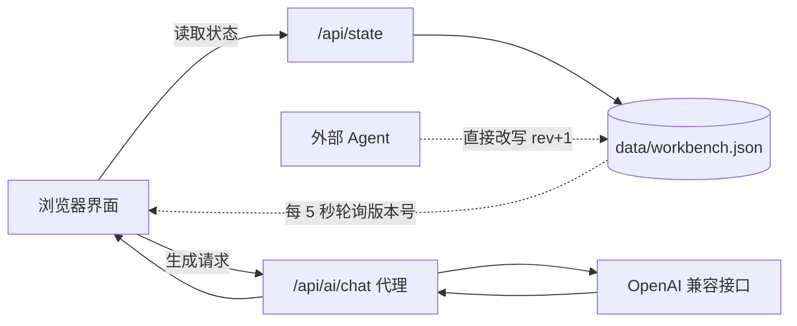

# 家教老师 AI 工作台

一对一家教老师的**本地优先**工作台：教材、题库、学生档案、课次材料、排期全部落在同一个文件夹里，
双击启动、不联网也能用，整个目录拷给别人就能复用。AI 只负责生成，上下文拼装、检索与落盘留在本地。

- 零依赖、零构建：`node server.mjs` 即跑，前端是原生经典脚本 + `window` 命名空间
- 依赖全部 vendor 在 `assets/vendor/`（pdf.js、marked、KaTeX），**不引 CDN**，断网可用
- 数据是纯 JSON，可读、可 diff、可被外部 Agent 直接改写

## 四个模块

| 模块 | 做什么 |
| --- | --- |
| 教材管理 | 上传 PDF / Markdown / TXT，PDF 自动提取文字并切片，备课只检索相关片段 |
| 题库管理 | 试卷按题号自动拆分，支持 AI 智能拆分；六维筛选（学科/学段/年级/题型/难度/知识点），每题带稳定编号 `#Q12` |
| 学生管理 | 档案 + 沟通记录 + **课次看板**（学情分析 / 课前习题 / 教案 / 课后总结四行，按课次横向排开） |
| 学生排期 | 周视图排课，汇总本周课程数、总课时、涉及学生 |

备课结果里的 `#Q12` 会渲染成可点击标签，点开可回查原题、答案与解析。

## 界面

截图取自内置示例数据，学生页点「载入示例」即可复现同一套内容。

### 学生列表：一张卡就是一位学生的当前状态



卡片上直接给出年级科目、学习进度、下次课时间、课次完成数，以及最近一节课四项材料的完成比例。
顶部统计条汇总在读人数、累计课次、本周课程与本周已完成数。

### 学生档案：喂给 AI 的上下文都在这里



辅导目标、薄弱点、学习习惯填写得越细，生成的材料越贴身；右侧沟通记录按时间线累积。
档案下方的课次看板是核心工作区：



按课次横向排开，四行固定为「课前学情分析 / 课前习题 / 教案 / 课后总结」。
点空白格让 AI 生成或手动填写，已有内容的单元格标注来源与更新时间，一眼能看出哪次课还没备。

### AI 备课：一次生成四栏，偏好同时作用于选题



选课次、勾要生成的栏目、补一句本次侧重点，再设定年级 / 题型 / 难度 / 知识点。
这些偏好既筛题库也筛教材片段；底部「外部 Agent 协作」是给不配 Key 的用法留的入口。

### 题库：六维筛选 + 稳定编号



学科、学段、年级、题型、难度、知识点可任意组合，每个选项后带命中数量。
题目编号稳定不变，AI 生成内容里的「改自题库 #03」点开就是这一题。

### 教材：切片入库，检索时只取相关段落



PDF / Markdown / TXT 拖进来即提取与切段，切片用于备课检索，不会把整本书塞进上下文。

### 排期：周视图 + 本周概览



按天分列，课程块带学生、时间、科目与地点；下方汇总本周课程数、总课时与「接下来」的课。

### 设置：两条 AI 通道并列



内置直连与外部 Agent 协作可同时开启，Key 只写本机 `data/secrets.json`；
数据区负责导出导入、载入示例与清空。

## 快速开始

需要 Node.js 18 及以上（无需 `npm install`）。

```bash
git clone <this-repo>
cd <repo>
node server.mjs
```

浏览器打开 `http://127.0.0.1:5173`。macOS 也可以直接双击 `启动工作台.command`，
端口被占用时从 5173 自动顺延，以终端打印的地址为准。

首次启动会自动创建空的 `data/` 与 `data/files/`。

## AI 怎么接

两条通道，可同时使用：

| | A. 内置直连 | B. 交给 Agent |
| --- | --- | --- |
| 用法 | 设置里填 `baseUrl` / `model` / `apiKey`，点「AI 备课」勾选栏目一次生成 | 复制「任务包」粘给 WorkBuddy 等 Agent，返回 JSON 后「导入 AI 结果」；或让 Agent 直接写 `data/workbench.json` |
| 适合 | 日常高频生成 | 首次学情诊断、期末方案这类需要多轮打磨的 |

内置直连兼容任何 **OpenAI 兼容**接口：DeepSeek、通义、Kimi、智谱、OpenAI、本地 Ollama 等。
Key 只写入本机 `data/secrets.json`，由 `server.mjs` 做代理转发，浏览器侧不接触明文。



外部写文件时把 `rev` 加 1，前端轮询即可感知刷新——这是「Agent 直接写数据」能成立的前提。

## 目录结构

```
index.html                外壳与脚本装载顺序（util → store → qbank → ai → views → app）
server.mjs                本地服务：静态托管 / 状态读写 / AI 代理 / 文件上传
启动工作台.command        macOS 双击启动
使用说明.md               完整使用手册（含常见问题）
assets/css/style.css      全部样式，浅深色靠 [data-theme] 变量
assets/js/util.js         U.* 工具、抽屉/弹窗、Markdown + KaTeX 渲染、PDF 提取与切段
assets/js/store.js        状态层与持久化（乐观锁 + 防抖），双通道降级
assets/js/qbank.js        题库筛选与相关度排序，备课选题共用
assets/js/ai.js           上下文拼装、Prompt 模板、任务包、JSON 解析
assets/js/views/*.js      五个视图，各自注册 Actions
data/                     本机数据（不入库，见下）
.workbuddy/skills/        Agent 操作手册 + CLI，供外部 Agent 读写数据
```

## 数据与隐私

`data/` 已被 `.gitignore` 整体忽略，仓库里只有一个说明文件。不会进版本库的包括：

- `data/workbench.json` —— 学生档案、课次、题库、排期
- `data/secrets.json` —— `apiKey` / `baseUrl` / `model`
- `data/files/` —— 上传的教材与试卷原件
- `data/workbench.backup-*.json` —— 自动滚动备份

写入采用「临时文件 + 原子替换」，并带 `rev` 版本号做乐观锁，避免多端互相覆盖；
所有写入统一走 `Store.commit()`。迁移机器时整份复制 `data/` 即可，或使用界面里的导出/导入。

## 设计取舍

几个刻意的「不」，决定了这个项目的形状：

- **不做纯 `file://` + IndexedDB**：浏览器 5MB 上限、PDF worker 受限、存不下原件，外部 Agent 也读不到数据。
  改用零依赖 Node 服务 + 一个 JSON 文件，换来「可被别的程序读写」。
- **不引入构建工具与前端框架**：经典 `script` + `window` 命名空间，双击 `index.html` 仍能降级运行。
  代价是没有模块化，收益是十年后还能打开。
- **不引 CDN**：pdf.js / marked / KaTeX 全部 vendor 进仓库，断网可用、整包可拷给别人。
- **不用数据库**：`workbench.json` 是唯一真相，可读、可 diff、可手改。
  `rev` 乐观锁挡住多端覆盖，前端 5 秒轮询版本号，外部 Agent 改文件后界面自动跟上。
- **不在工作台里再嵌一个对话式 Agent**：重复造轮子，还会让数据出现两份真相。
  生成这一步开放成「内置直连」和「任务包交给 Agent」两条通道即可。

## 已知限制

- 扫描版 PDF 无文字层，需先 OCR（本工具不内置）
- PDF 抽出的公式常乱序，公式类内容建议用 Markdown 或手动修正
- 单人本地使用，多人协作需把持久化层换成云服务
- 课次看板暂不支持拖拽排序

## 许可

[MIT](LICENSE)。随意使用、修改、商用，保留版权声明即可。

欢迎提 issue 交流；如果要改数据层或加视图，建议先看一眼上面「设计取舍」，
这套代码的边界基本都由那几条决定。
